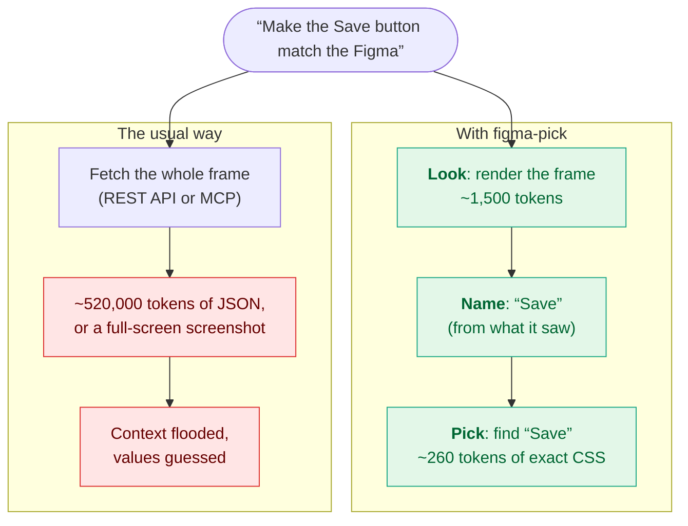
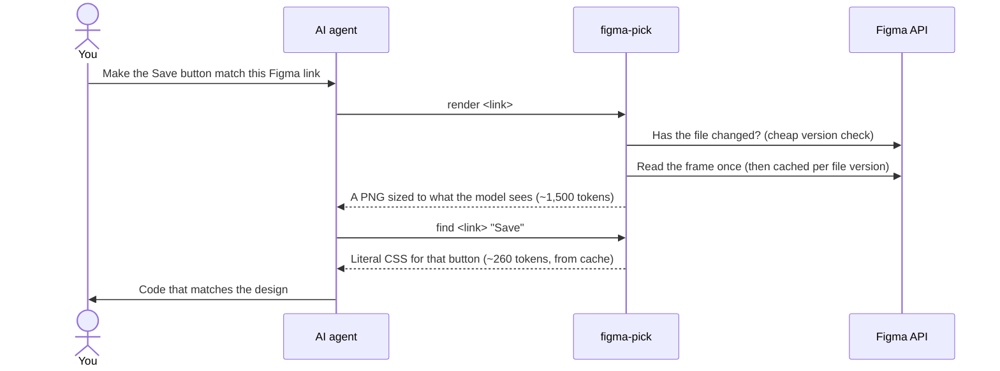

# figma-pick

**A Figma workflow for AI agents that a senior engineer would recognize: look once, point at what you need, and take its exact CSS. Nothing else.**

> In AI-assisted development, context is the scarcest resource you have. Every token of noise is attention your agent doesn't spend on your code, and a cost you pay again on every turn. figma-pick is a tool plus opinionated guidance for how AI agents should read Figma.

## The problem

You paste a Figma link and ask your agent to fix one button. Today it does one of two things:

- **It pulls the whole frame as JSON.** Figma's API returns 1–1.5 KB per layer, so one app screen is around **520,000 tokens** of layout bookkeeping (variable bindings, render bounds, constraints) before your agent reads a line of your code. And it stays in the conversation, re-read on every later turn.
- **It looks at a screenshot.** That's cheap, but pixels aren't values. A screenshot can't tell `#3e63dd` from `#3b5bdb`, 12px type from 13px, or a 0.5px hairline from a 1px border.

Either way, the agent guesses, and you review the guesses.

You can plug in a Figma MCP server and let the agent pull whatever it likes. That works the way copying a whole database to answer one query works. Your agent's context window, your token bill and your Figma API quota are all finite, so "it works" is not the bar. **Efficiency is.**

## The idea: look, name, pick

A senior engineer implementing a design doesn't read the whole Figma file. They look at the screen, find the element they're changing, and inspect exactly that. figma-pick teaches your agent the same moves.



1. **Look.** `render` the frame once, sized to exactly what the model can see (~1,500 tokens).
2. **Name.** From what it sees, the agent names the elements it needs: "Save", "Tabs", "the member badge".
3. **Pick.** `find` returns literal CSS for just those elements, about 100–300 tokens each, ready to copy verbatim.

## What it saves

Measured on a real 1440×1024 SaaS list screen with 1,297 layers:

```text
Tokens to inspect one screen (linear scale; the small bars are real)

Raw REST JSON                ████████████████████████████████████████████████  ~520,000
Framelink MCP, whole frame   ██                                                 ~22,000
figma-pick render            ▏                                                   ~1,500
figma-pick find, 4 elements  ▏                                                   ~1,300
figma-pick find, 1 element   ▏                                                     ~260
```

| Approach | Tokens |
|---|---:|
| Raw REST JSON for the frame | ~520,000 |
| Framelink MCP `get_figma_data`, whole frame | ~22,000 |
| `figma-pick render`: the whole frame, as the model sees it | ~1,500 |
| `figma-pick find` for 4 elements | ~1,300 |
| `figma-pick find` for 1 element | ~260 |
| `figma-pick outline`: the layer map with node ids | ~180 |
| `figma-pick render --node`: one button at 4× | ~80 |

Text is counted at about 3 characters per token; images use Anthropic's `width × height / 750` rule.

**It's also more exact than the alternatives.** Compared on the same frame:

- Shadow alphas keep the value Figma stored: `0.027`, where other tools round to `0.03`, one 8-bit step off.
- Outside strokes become `outline`, so they don't shift your layout.
- Per-corner radii, OpenType features (`font-feature-settings`) and leading trim (`text-box`) all come through.

**It's fast after the first look.** The first read of a frame took 3.6 s, all of it Figma's latency. Every later `find`, `outline`, `text` or `css` on that frame took 0.1 s and made no API calls.

## How a request flows



## The guidance it gives your agent

The tool is half of figma-pick. The other half is the pattern: figma-pick ships as a Claude Code skill, and these are the rules it gives your agent.

- **Never fetch a whole page or frame as JSON,** and never read a full-screen image to inspect one button.
- **Look once, then name the elements.** When the request already names them, `render` and `find` run together.
- **Copy values verbatim.** Use a design token only when it matches exactly; otherwise use the literal value and say so. Never substitute a "nearest" colour.
- **Reuse the design system.** `(Set: Variant=Value)` marks an instance of an existing component, so find that component in your codebase before writing new markup.
- **Respect the budget.** Figma gives View and Collab seats [about 20 file reads a month](https://developers.figma.com/docs/rest-api/rate-limits). Every read is cached per file version, so repeats, sub-agents and follow-up questions cost nothing.

A **guard hook** enforces the first rule even when the skill isn't loaded. It blocks raw full-file fetches through `curl`, and Figma MCP calls without a node and depth, and points Claude back to figma-pick.

## Example

```text
$ figma-pick find "<figma link>" "Save changes" "Admin"
# Workspace settings > Header
FRAME "Button/Primary" 116x32 [1:102] { display:flex; justify-content:center; align-items:center; gap:6px; padding:0 12px; height:32px; background:#3e63dd; border-radius:6px; box-shadow:0 1px 2px rgba(0,0,0,0.05) }
  VECTOR "check" 16x16 { width:16px; height:16px; stroke:#ffffff; stroke-width:1.5px }
  TEXT "Save changes" 50x20 { font:500 14px/20px "Inter"; letter-spacing:-0.1px; color:#ffffff }
# Workspace settings > Members > Member row
FRAME "Badge" 52x22 [1:105] { display:flex; align-items:center; padding:0 8px; height:22px; background:#edf2fe; border:1px solid #c1d0ff; border-radius:11px }
  TEXT "Admin" 50x20 { font:500 12px/16px "Inter"; color:#3a5bc7 }
# +2 more with identical CSS: [1:109] [1:113]
# ~248 tokens, node JSON ~3,228 · figma api: none (cached)
```

## Install

**As a Claude Code plugin**, which installs the skill plus the guard hook:

```bash
claude plugin marketplace add shobhitg/figma-pick
claude plugin install figma-pick@figma-pick
```

Then paste a Figma link, or type `/figma-pick <link> the Save button`.

**As a plain skill**, without the hook:

```bash
git clone https://github.com/shobhitg/figma-pick
ln -s "$PWD/figma-pick/skills/figma-pick" ~/.claude/skills/figma-pick   # `git pull` updates it
```

**As a CLI**, for any agent or for you: `python3 skills/figma-pick/scripts/figma_pick.py --help`. It needs Python 3.9+ and nothing else.

**Token.** In Figma, go to Settings > Security > Personal access tokens. Create a token with the scopes *File content: read* and *File metadata: read*, then `export FIGMA_TOKEN=figd_...`. figma-pick also accepts `FIGMA_API_KEY`, or the key of a Framelink `figma` MCP server already configured in `~/.claude.json`.

**Updates.**
- Plugin users get a new release with `claude plugin update figma-pick@figma-pick`.
- To update automatically, turn on auto-update for this marketplace under **Marketplaces** in `/plugin`.
- Releases are tagged, so you can pin one: `claude plugin marketplace add shobhitg/figma-pick#v0.1.1`.

## Commands

Every command takes a Figma link. *Copy link to selection* gives you one with a `node-id`.

| Command | Prints |
|---|---|
| `render <link> [--node ID ...] [--format svg] [--out PATH]` | A PNG of the frame or of chosen elements, scaled so the model sees it sharp without downscaling. Several `--node` values cost one API call. Use SVG for icons. |
| `find <link> TEXT [TEXT ...]` | Literal CSS for the layers whose name or visible text contains TEXT, with 2 levels of children (`--depth`). |
| `outline <link>` | The layer tree with node ids, to choose what to `find` or `render`. |
| `css <link> --node ID` | Literal CSS for one subtree. |
| `text <link>` | Every visible string, deduplicated. |

A link without a `node-id` lists the file's pages and frames instead of fetching a page. Output over about 4,000 tokens is refused, with advice on narrowing it; `--max-tokens` and `--out FILE` are the escape hatches.

## Reading the output

One line per layer, indented by depth:

```text
TYPE "label" WxH [id] (Component: Variant=Value) { literal css } /* what CSS can't carry */
```

- **The values are literal.** Colours are hex, or `rgba()` with the alpha Figma stored. Sizes, fonts, OpenType features, leading trim and shadows are exactly what the design says.
- **A text match reports the styled element around it.** Searching for "Save changes" returns the button, not the glyph run.
- **Repeats are folded.** Matches that would print identically become `+N more with identical CSS: [ids]`, and look-alike siblings such as table rows become `+N more like this`.
- **Instances name their design-system component and variant.**

## Caching and Figma's rate limits

- **A cheap check comes first.** Before reusing a cached frame, figma-pick asks Figma's metadata endpoint for the file's `version` and `last_touched_at`, at most once a minute. If neither has changed, nothing is downloaded.
- **Any edit invalidates the file's cache.** Figma offers no per-layer hash or ETag, so a file-level version plus last-modified time is the finest change signal available.
- **Everything inside a cached frame is free.** `find`, `outline`, `css`, `text` and `render --node` on anything inside a cached frame make no file reads. Parallel calls share one read through a file lock.
- **When rate-limited, it serves the last cached version**, with a warning, rather than failing.
- **The cache lives in `~/.cache/figma-pick`**; set `FIGMA_PICK_CACHE` to move it.

The last line of every command reports the API calls it made.

## What's captured

| Area | Captured |
|---|---|
| Layout | Auto layout as flex; fixed, hug and fill sizing; min and max sizes; absolute positions in plain frames |
| Fills | Solid colours; linear gradients, including ones stretched with their layer; radial gradients |
| Strokes | Inside strokes as `border`; outside and centre strokes as `outline`; per-side widths; dashes |
| Shape and effects | Corner radii, drop and inner shadows, layer and background blur, opacity, blend modes, clipping |
| Text | The `font` shorthand, letter-spacing, alignment, case, decoration, OpenType features, leading trim, truncation, and mixed-style runs |
| Naming | Component and variant names, and named styles |

Some things aren't captured, and are flagged inline in a `/* note */` so the agent knows to check the render: image fills, angular and diamond gradients, vector geometry (use `render --format svg`), rotation, grid tracks, constraints, and variable names.

## Development

```bash
python3 -m unittest discover -s tests
```

The tests use synthetic Figma JSON and a fake API, so they need no token or network access.

## License

MIT
